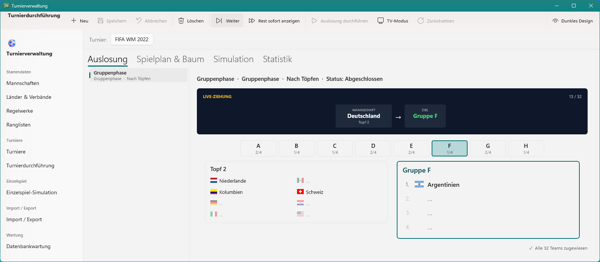
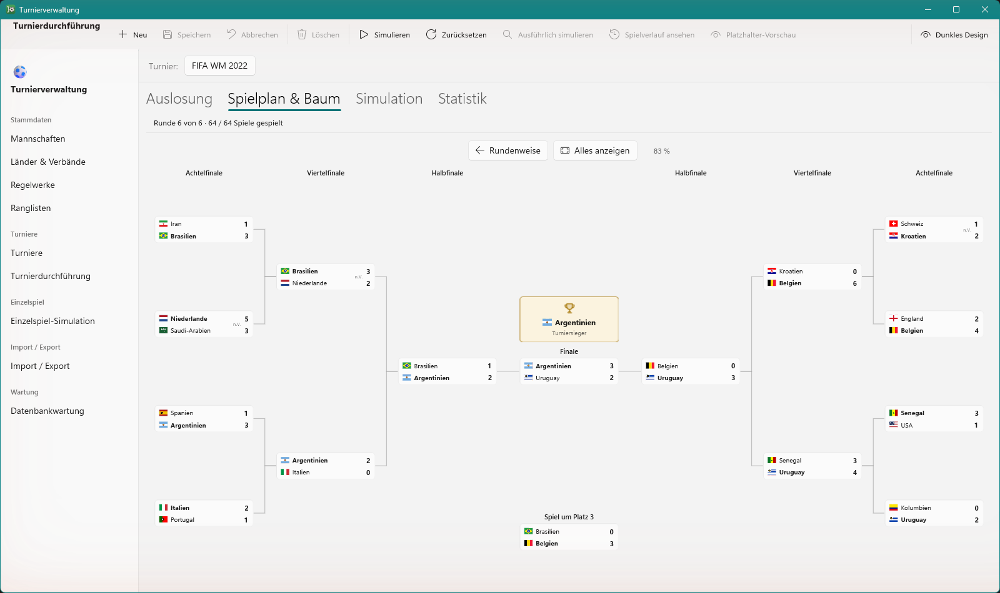
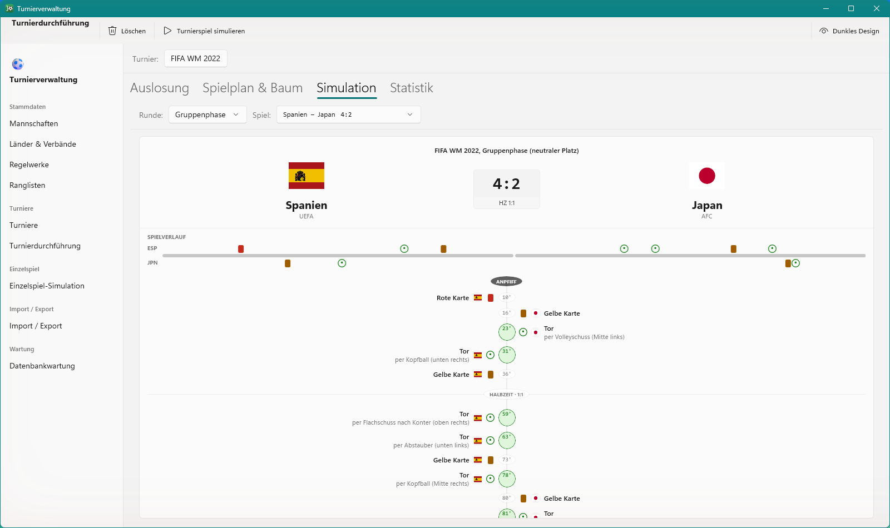
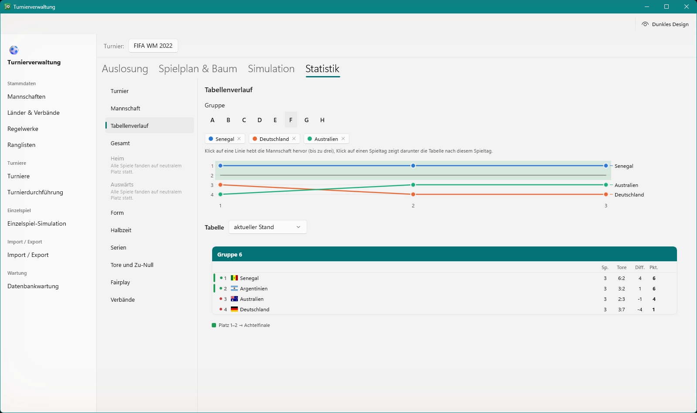
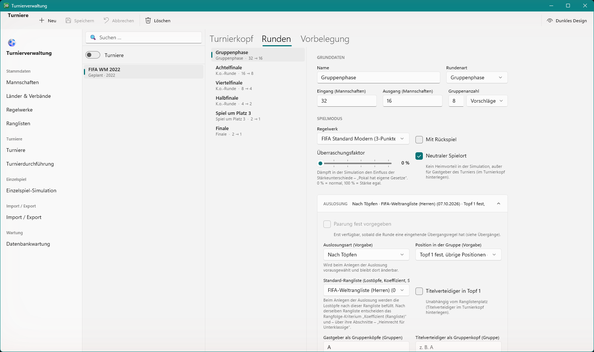

# Fussballturnierverwaltung

[](https://github.com/MZurmuehlen89/Turnierverwaltung/actions/workflows/unit-tests.yml)
[](https://github.com/MZurmuehlen89/Turnierverwaltung/actions/workflows/gui-tests.yml)

Desktop-Anwendung zum Planen, Auslosen, Simulieren und Auswerten von Fußballturnieren – von der WM-Gruppenphase mit
Lostöpfen und Verbandsregeln bis zum Europapokal mit Hin- und Rückspiel und Auswärtstorregel. Geschrieben in C# mit
WinUI 3 und Entity Framework Core, nach Clean Architecture und mit einer Testpyramide bis hinauf zu automatisierten
GUI-Tests.

> **English summary:** A Windows desktop app (C#, .NET 10, WinUI 3, EF Core, SQL Server) for configuring, drawing,
> simulating and evaluating football tournaments of any format – groups, knockout rounds, two-legged ties, Swiss
> system. Built with Clean Architecture and tested from unit to GUI level (xUnit, architecture tests, mutation
> testing with Stryker.NET, FlaUI-based GUI tests in CI). The domain language and code are German. Developed together
> with Claude Code as AI pair programmer – see “Entstehung mit Claude Code” below.



## Funktionsumfang

- **Turniere frei konfigurieren:** beliebige Abfolge von Runden (Gruppenphase, K.-o.-Runde, Liga, Schweizer System),
  Übergangsregeln zwischen den Runden, Turniervorlagen für wiederkehrende Formate
- **Auslosung:** Lostöpfe, Setzlisten und Regeln (z. B. keine zwei Teams desselben Landes, kein Wiedersehen aus
  derselben Gruppe), Teilnehmerquoten je Verband; vor jeder
  Ziehung prüft die Engine, ob noch eine gültige Auslosung möglich ist, und vermeidet Sackgassen
- **Simulation:** wahrscheinlichkeitsbasiert (Poisson-Modell aus Offensiv-, Mittelfeld- und Defensivrating) mit
  Liveticker; per Seed reproduzierbar
- **Regelwerke als Daten:** Punkte (2 oder 3 pro Sieg), Tabellenkriterien, Verlängerung, Golden Goal, Elfmeterschießen,
  Auswärtstorregel – auch historische Regeln lassen sich abbilden
- **Auswertung:** Tabellen mit Verlauf, Turnierbaum, Statistiken, Ranglisten
- **Stammdaten:** Mannschaften, Länder, Verbände; Import und Export als CSV und JSON
- Mitgelieferte Daten: Turnierformate, Ranglisten und Abschlusstabellen aus öffentlichen Quellen

| | |
|---|---|
|  |  |
|  |  |

## Technik

| Bereich | Technik |
|---|---|
| Sprache, Plattform | C# 14, .NET 10 |
| Oberfläche | WinUI 3 (Windows App SDK), MVVM mit CommunityToolkit.Mvvm |
| Daten | Entity Framework Core 10 (Code First, Migrationen), SQL Server |
| Hosting, Logging | Microsoft.Extensions.Hosting (DI, Konfiguration), Serilog |
| Tests | xUnit v3, FluentAssertions, NetArchTest, Stryker.NET, FlaUI (UI Automation) |
| Statische Analyse | SonarAnalyzer.CSharp, Roslynator |
| CI | GitHub Actions (Unit-Tests auf Linux, GUI-Tests auf Windows), Dependabot |

## Architektur in Kürze

```
Domain  <──  Application  <──  Infrastructure  <──  WinUi
```

| Projekt | Inhalt |
|---|---|
| `Domain` | Entitäten und Enums, keine Abhängigkeiten |
| `Application` | Fachlogik: Auslosung, Spielplangeneratoren, Simulation, Tabellenberechnung, Validierung; definiert die Repository-Schnittstellen |
| `Infrastructure` | EF Core, Repositories, Migrationen, Seed, Import/Export |
| `WinUi` | Oberfläche und einzige Kompositionswurzel |

Die Abhängigkeitsrichtung ist durch Architekturtests abgesichert. Fachbegriffe sind durchgängig deutsch
(`Auslosung`, `Lostopf`, `TurnierRunde`), damit Code und Fußballregeln dieselbe Sprache sprechen. Domänenmodell und
Architekturentscheidungen: [ARCHITEKTUR.md](ARCHITEKTUR.md).

## Tests

| Ebene | Was | Wo |
|---|---|---|
| Unit- und Integrationstests | rund 2.100 Tests für Fachlogik, Repositories (EF Core InMemory) und Seed | `tests/Fussballturnierverwaltung.Tests`, CI bei jedem Push |
| Architekturtests | Schichtabhängigkeiten und Namenskonventionen (NetArchTest) | `tests/…/Architektur` |
| Mutationstests | Stryker.NET auf Auslosung, Spielplan, Tabelle und Simulation – prüft, ob die Tests Fehler auch finden | `build/Mutation-Ausfuehren.ps1` |
| GUI-Tests | über 100 Szenarien, die die echte App per UI Automation bedienen, mit eigener Test-DB und festem Zufalls-Seed | `tests/Fussballturnierverwaltung.GuiTests`, eigenes Framework in `tests/GuiTest.Framework` |

## Entstehung mit Claude Code

Das Projekt ist seit Juni 2026 in rund 1.000 Commits und gut 500 Issues entstanden, durchgehend im Zusammenspiel
mit [Claude Code](https://claude.com/claude-code) als KI-Pair-Programmer. Interessant ist dabei weniger, *dass* eine
KI Code schreibt, sondern wie man sie in einem wachsenden Projekt auf Kurs hält.

**Rollenverteilung**

- **Mensch:** Produktidee und Fachlichkeit (welche Regeln, welche Turnierformate), Prioritäten und Phasenplanung,
  Entscheidungen zu UX und Architektur, Abnahme in der laufenden App
- **KI:** Umsetzung über alle Schichten, Tests, Fehleranalyse, Issue-Pflege, Reviews – nach Plan und Rückfrage bei
  Konzeptfragen

**Leitplanken** – Regeln, die nicht vom Gedächtnis der KI abhängen, sondern maschinell greifen:

- **Gestufte `CLAUDE.md`:** eine Datei im Wurzelverzeichnis mit Architektur, Konventionen und Clean-Code-Regeln,
  dazu je eine für Infrastructure, WinUi und die Tests, die erst geladen wird, wenn dort gearbeitet wird. So bleibt
  der Kontext klein und die Fallstricke stehen dort, wo sie zuschlagen.
- **Hooks** (`.claude/hooks`): vor jedem Commit Build, Prüfung auf fehlende EF-Migrationen und Unit-Tests; ein Push
  mit uncommitteten Änderungen wird blockiert.
- **Statische Analyse** bei jedem Build; die Clean-Code-Schwellen (Methodenlänge, kognitive Komplexität,
  Parameterzahl) erscheinen als Warnungen.
- **Architekturtests** halten die Schichtung, **Mutationstests** die Testqualität.
- **KI-Review** (`/code-review`) vor jedem Push.
- **GUI-Tests in CI** fangen ab, was Unit-Tests in einer WinUI-Oberfläche nicht sehen.
- **Issues als Gedächtnis:** jede Änderung hat ein Issue mit Plan, Messwerten und Abschlusskommentar; Commits
  verweisen darauf.

## Selbst bauen

Voraussetzungen: Windows 10/11, .NET 10 SDK, SQL Server (Developer Edition oder LocalDB). Die Verbindung steht in
`src/Fussballturnierverwaltung.WinUi/appsettings.json` (Standard: lokale Instanz `.`).

```bash
# Anwendung starten – legt die Datenbank beim ersten Start an, spielt Migrationen ein und ergänzt die mitgelieferten Daten
dotnet run --project src/Fussballturnierverwaltung.WinUi

# Unit-Tests
dotnet test --project tests/Fussballturnierverwaltung.Tests

# GUI-Tests (steuern die echte App, eigene Test-DB; Maus und Tastatur währenddessen nicht benutzen)
pwsh build/GuiTests-Ausfuehren.ps1
```

## Bildmaterial

Die Länderflaggen stammen aus flag-icons (MIT, siehe [THIRD-PARTY-NOTICES.md](THIRD-PARTY-NOTICES.md)).
Vereinswappen, Bilder der Nationalmannschaften sowie Turnier- und Verbandslogos sind Marken oder urheberrechtlich
geschützt und deshalb nicht im Repo – die Anwendung zeigt an ihrer Stelle einen Platzhalter. Wer das Bildmaterial
besitzt, legt es als `<Kategorie>/<Code>.png` in den git-ignorierten Ordner
`src/Fussballturnierverwaltung.Infrastructure/Seed/Bildmaterial/Privat/`; der Build bettet es ein, der Seed übernimmt
es beim nächsten Start. Wie es ursprünglich beschafft wurde, dokumentieren die Skripte unter `tools/seed-bildmaterial`.

## Lizenz

Alle Rechte vorbehalten. Der Quelltext ist zum Ansehen veröffentlicht; Nutzung, Weitergabe und Veränderung
außerhalb der Funktionen von GitHub (Ansehen, Forken) sind ohne Zustimmung nicht gestattet. Inhalte Dritter stehen
unter ihren eigenen Lizenzen, siehe [THIRD-PARTY-NOTICES.md](THIRD-PARTY-NOTICES.md).
